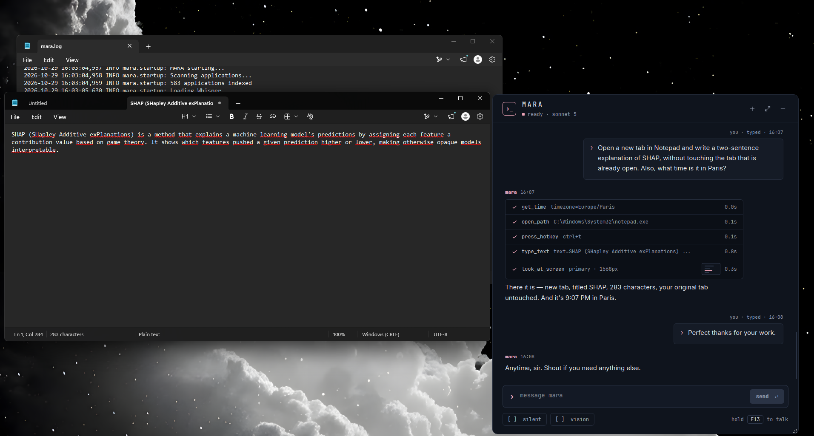
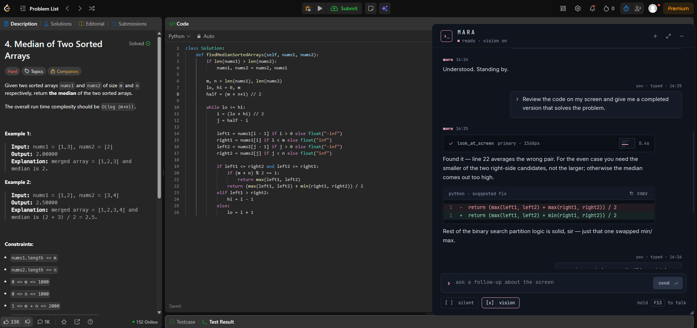
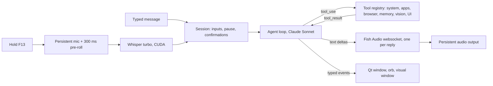

# MARA — Personal AI Assistant
### Modular Adaptive Response Assistant

> A voice-driven personal assistant for Windows, inspired by JARVIS: hold a mouse button, talk, and MARA answers out loud and acts on your PC.

---

## What is MARA?

MARA lives on your machine. You hold a button (F13, mapped to a mouse button), speak, and release. Whisper transcribes locally on the GPU, Claude Sonnet decides what to do with native tool calls (open apps, change the volume, read a web page, look at your screen, remember things), and Fish Audio speaks the answer while it is still being written. A terminal-style chat window shows the conversation, the actions MARA ran, and any code she suggests.

## Screenshots

<p align="center">
  
  
</p>
<p align="center"><sub>Left: voice request with one receipt per action. Right: <code>look_at_screen</code> reviews the code on screen and answers with a diff.</sub></p>

## How it works



- **One conversation thread.** The history keeps the real `tool_use` / `tool_result` blocks, so "summarise what we did" works after an action, a visual or a screenshot.
- **Agent loop.** Sonnet streams text; when it calls tools, they run, their results go back to Sonnet, and it continues (up to 8 rounds). Errors and network failures end the turn cleanly and are shown in the chat.
- **Typed events** (`core/events.py`) are the only contract between the core and the interface. `python -m core.cli` drives the same agent from a terminal.
- **Risk levels.** Every tool is `read`, `local` or `confirm`. Confirm tools (closing apps, deleting saved logins, erasing memory) show a confirmation card you answer by click or by saying yes / cancel. After MARA reads a web page or your screen, even `local` actions need confirmation for a while, so text hidden in a page cannot drive your PC.

## Features

**Voice**: push-to-talk on F13, local Whisper (language detected by Whisper: English, French, Arabic), streaming Fish Audio TTS that starts on the first phrase, barge-in (press F13 while MARA talks to cut her off), silent mode.

**System**: launch and close apps (installed-app registry built at startup), open files, folders and URLs, file search (Windows Search index, bounded disk scan as fallback), type text and keyboard shortcuts, volume, mute, brightness, WiFi, the real time in any city, screenshots, pause ("leave me alone until 9 pm", wake her by saying "MARA"), work session (VS Code, Chrome, Edge).

**Browser**: a dedicated Chrome profile driven by Selenium (navigate, click, type, read), logins for Gmail, Outlook and Brightspace from an encrypted vault. Passwords are typed in a local dialog and never reach the model.

**Vision**: `look_at_screen` captures the monitor under your cursor (MARA's own windows are hidden), downscaled JPEG in memory only. Ask what is on screen or "what's wrong with this function?": MARA answers in a sentence and shows the fix as a diff in the chat. The `vision` toggle lets her look on her own when it helps.

**Memory**: facts, preferences and current context about you, extracted in the background by Claude Haiku, encrypted with a key protected by Windows DPAPI, used implicitly and never recited.

**Interface**: a sober terminal-style window (Inter + JetBrains Mono), action receipts with timings, code blocks with copy, live transcription while you speak, real mic level, tray icon, a 3D orb that shows listening / thinking / speaking / waiting.

## Setup

Requirements: Windows 10/11, Python 3.11, an NVIDIA GPU with CUDA for Whisper (CPU works but is slow), Google Chrome for browser features.

```
git clone <this repo> MARA
cd MARA
python -m venv venv
venv\Scripts\activate
pip install -r requirements.txt
pip install torch==2.5.1 --index-url https://download.pytorch.org/whl/cu121
```

`openai-whisper` pulls a CPU build of PyTorch; the second `pip install` replaces it with the CUDA build. Check with `python -c "import torch; print(torch.cuda.is_available())"`.

Create `.env` in the repo root:

```
ANTHROPIC_API_KEY=sk-ant-...
FISH_API_KEY=...
USER_NAME=YourFirstName
```

Optional: edit `%APPDATA%\MARA\profile.md` (created from `profile.example.md` on first start) to tell MARA about yourself.

### F13 push-to-talk

F13 does not exist on most keyboards, so nothing else uses it. Map a spare mouse button to F13 in your mouse software (Logitech G HUB: assign the button a keystroke and pick F13). If your software cannot send F13, an AutoHotkey line such as `XButton1::F13` does it. Any other key works too: change `TRIGGER_KEY` in `core/config.py`.

## Run

```
venv\Scripts\activate
python main.py
```

The window starts hidden: use the tray icon, say "show the interface", or set `START_HIDDEN = False` in `core/config.py`. Quit from the tray menu or by asking MARA to shut down.

`python -m core.cli` runs the agent in a terminal (no voice, no Qt). Developer checks: `pip install -r requirements-dev.txt`, then `powershell scripts\check.ps1` (compileall, ruff, pytest).

## Data

| What | Where |
|---|---|
| Memory, credentials (`*.enc`), DPAPI-protected key (`mara.key.dpapi`), `profile.md`, `app_registry.json` | `%APPDATA%\MARA` |
| Logs (`mara.log`, with one `[Latency]` line per turn) | `%LOCALAPPDATA%\MARA\logs` |
| MARA's Chrome profile | `%LOCALAPPDATA%\MARA\ChromeProfile` |
| Screenshots you ask for | `Pictures\Screenshots` |

On the first start after updating, the old plaintext `mara.key` is moved to DPAPI protection and kept as `mara.key.bak`; delete the backup once MARA works. Window size and position are stored by Qt in the registry (`HKCU\Software\MARA`).

## Configuration flags (`core/config.py`)

| Flag | Default | Effect when changed from the default |
|---|---|---|
| `STREAMING_TTS` | True | Speak sentence by sentence, one Fish request each (slower, older path) |
| `PERSISTENT_AUDIO_OUT` | True | Open the speaker stream for each reply |
| `PERSISTENT_MIC` | True | Open the microphone only while F13 is held (no pre-roll) |
| `BARGE_IN` | True | Pressing F13 while MARA talks is ignored |
| `PROMPT_CACHE` | True | No prompt caching |
| `WARMUP_REQUEST` | True | No tiny API request at startup |
| `LIVE_TRANSCRIPTION` | True | No partial transcript while you speak |
| `ORB_IDLE_VISIBLE` | False | The orb stays visible, dimmed, when idle (by default it appears only when MARA listens, thinks or speaks) |
| `START_HIDDEN` | True | The window opens at launch |

## Troubleshooting

- **"Whisper ready (cpu)"**: the CUDA build of PyTorch is not installed, see Setup.
- **No voice**: check `FISH_API_KEY`, the default output device, and `mara.log`. If speech is garbled, set `STREAMING_TTS = False`.
- **F13 does nothing**: the `keyboard` hook may need MARA to run with the same privileges as the focused app; check your mouse mapping with a key tester.
- **"Cannot reach Claude"** in the chat: network or API key problem; the next message works once it is back.
- **Browser actions fail**: Chrome must be installed; Selenium downloads a matching chromedriver on first use.
- **Memory looks empty**: if the file could not be read it was copied to `mara_memory.enc.<date>.corrupt` in `%APPDATA%\MARA`; nothing is deleted.

## Project layout

```
MARA/
├── main.py                  # Qt app, window, orb, worker, wiring
├── core/
│   ├── brain.py             # Agent loop, prompt, history, confirmations
│   ├── session.py           # Input queue, pause/wake word, speech per turn, barge-in
│   ├── events.py            # Typed events between core and UI
│   ├── cli.py               # Terminal frontend
│   ├── tools/               # registry + system, app, browser, memory, vision, UI tools
│   ├── listener.py          # F13, persistent mic, Whisper
│   ├── voice.py             # Fish Audio streaming TTS, audio output
│   ├── text.py              # Text cleaning, sentence splitting, markdown helpers
│   ├── system.py            # Volume, brightness, WiFi, time, capture, modes, pause
│   ├── browser.py           # Selenium Chrome
│   ├── app_registry.py      # Installed apps scan
│   ├── metrics.py           # Latency recap per turn
│   ├── shutdown.py          # Closes Chrome, mic and audio on exit
│   ├── orb.py               # 3D orb
│   └── ui/                  # theme, window, messages, composer, visual window, password dialog, worker
├── memory/                  # encrypted memory, credentials vault, DPAPI key store
├── assets/fonts/            # Inter and JetBrains Mono (SIL OFL)
├── scripts/check.ps1        # compileall + ruff + pytest
└── tests/                   # pytest suite, all fakes (no network, GPU or microphone)
```

## Cost

Roughly **$3.50–7.50/month** in API costs: Claude Sonnet ~$2–6 (less with prompt caching), Claude Haiku for memory extraction ~$0.50, Fish Audio ~$1. Speech recognition runs locally.

---

*Built by Ibrahim — Ottawa, 2026*